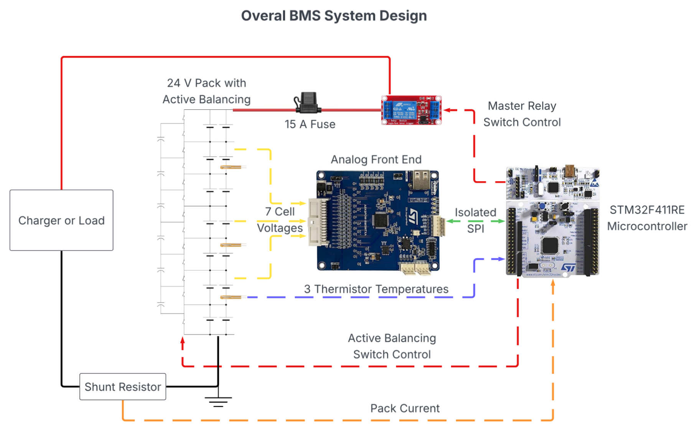
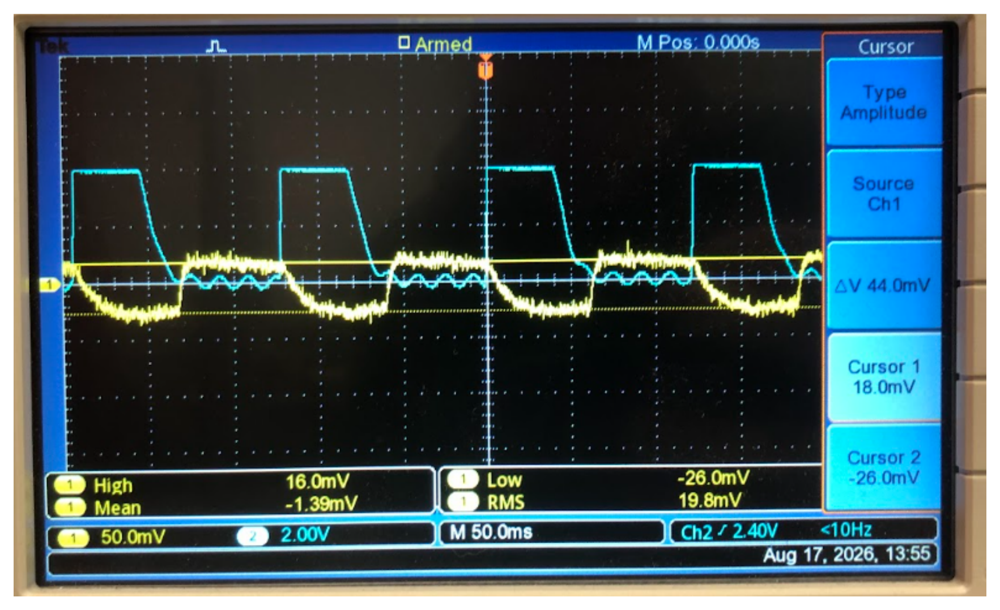
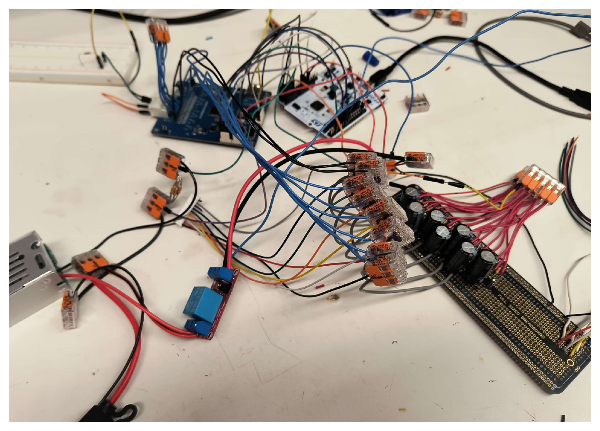

# 24V Li-Ion Battery Management System

Senior electrical engineering design project implementing a Battery Management System (BMS) for a custom **2P7S lithium-ion battery pack**. The completed prototype uses an **STM32F411RE** microcontroller and **ST L9963E** battery-monitoring AFE to monitor battery conditions, provide fault protection, perform active cell balancing, and transmit real-time telemetry to a LabVIEW PC interface.

## Project Overview

The BMS was developed for a nominal **25.2 V, 5.0 Ah** lithium-ion battery pack constructed from Samsung INR18650-25R cells. Seven series-connected cell groups are monitored individually, with two cells connected in parallel per group.

The completed system integrates battery monitoring, embedded firmware, protection logic, active balancing, PC telemetry, battery-pack construction, and a custom mechanical enclosure into a functional prototype.

### Key Features

- 2P7S lithium-ion battery pack
- Seven individual cell-group voltage measurements
- Pack-current measurement
- Three battery temperature measurements
- Cell undervoltage and overvoltage protection
- Pack overcurrent protection
- Battery overtemperature protection
- Master relay control for battery protection
- Chained switched-capacitor active cell balancing
- Real-time UART telemetry
- LabVIEW PC monitoring interface
- Custom battery and electronics enclosures

## System Hardware

| Component | Description |
| --- | --- |
| Battery | 2P7S Samsung INR18650-25R Li-ion pack |
| Nominal Voltage | 25.2 V |
| Maximum Voltage | 29.4 V |
| Pack Capacity | 5.0 Ah |
| Microcontroller | STM32F411RE |
| Battery Monitor | ST L9963E |
| AFE Interface | ST L9963T |
| MCU/AFE Communication | SPI2 |
| PC Communication | USART2 UART |
| Firmware | C using STM32 HAL |
| PC Interface | LabVIEW |
| Balancing | Chained switched-capacitor active balancing |

## System Architecture

<p align="center">
  
</p>

The **L9963E battery-monitoring IC** measures the seven series cell-group voltages and communicates with the STM32F411RE through the L9963T interface. Additional STM32 ADC channels acquire pack-current and thermistor measurements.

The STM32 processes the battery measurements, evaluates protection conditions, controls the master relay, operates the active-balancing circuitry, and transmits battery data through USART2 to the LabVIEW PC interface.

The embedded application uses a polling-based superloop rather than an RTOS scheduler.

## Battery Monitoring and Protection

The firmware monitors:

- Seven cell-group voltages
- Overall pack voltage
- Pack current
- Three battery temperatures

Battery measurements are continuously evaluated by the protection logic. The master relay is enabled only when the monitored battery conditions satisfy the implemented safety limits. A detected voltage, current, temperature, or invalid-voltage condition disables the relay.

Cell-voltage protection includes both undervoltage and overvoltage detection. Pack-current and battery-temperature limits provide additional protection for the completed prototype.

## Active Cell Balancing

The system uses a **chained switched-capacitor active-balancing topology**. Capacitors are alternately connected between adjacent cell groups using solid-state switching, allowing charge to move between cells with different voltage levels.

The final prototype demonstrated active balancing during system testing and the final project demonstration. The implemented topology successfully transferred charge between adjacent cell groups, although the balancing current was relatively low and could be improved in a future design.

<p align="center">
  
</p>

<p align="center">
  <em>Oscilloscope capture from active-balancing development and testing.</em>
</p>

## UART Telemetry and LabVIEW Interface

The STM32 transmits battery information to a PC over **USART2 at 115200 baud**.

The telemetry includes:

- Pack voltage
- Seven cell-group voltages
- Three temperature measurements
- Pack current
- Fault status
- Faulted cell information
- Measurement validity information

The LabVIEW interface receives and parses the serial data and provides real-time visualization of the battery measurements.

Example telemetry from the completed system:

```text
PACK: 27.470 V | CELLS: 3.828 3.947 3.953 3.929 3.930 3.943 3.940 V | TEMP: 73 F 73 F 89 F | CURRENT: +7 mA | FAULT: OK | CELL: 0 | VALID[V:1]
```

## Firmware

The STM32 firmware is located in:

[`firmware/EE490BMS/`](firmware/EE490BMS/)

The primary firmware files include:

- [`main.c`](firmware/EE490BMS/Core/Src/main.c) - STM32 initialization and main BMS superloop
- [`bms_app.c`](firmware/EE490BMS/Core/Src/bms_app.c) - Higher-level BMS measurement and protection processing
- [`bms_app.h`](firmware/EE490BMS/Core/Inc/bms_app.h) - BMS application definitions
- [`L9963E_utils.c`](firmware/EE490BMS/Core/Src/L9963E_utils.c) - Application interface to the L9963E driver
- [`L9963E.c`](firmware/EE490BMS/Core/Src/L9963E.c) - L9963E functionality
- [`L9963E_drv.c`](firmware/EE490BMS/Core/Src/L9963E_drv.c) - Low-level L9963E communication
- [`stm32_if.c`](firmware/EE490BMS/Core/Src/stm32_if.c) - STM32 hardware interface for the L9963E driver
- [`EE490BMS.ioc`](firmware/EE490BMS/EE490BMS.ioc) - STM32CubeMX configuration

The firmware was developed using **STM32CubeIDE** and **STM32CubeMX**.

## PC Interface

The LabVIEW PC interface is located in:

[`pc_interface/`](pc_interface/)

The interface receives UART telemetry from the STM32 and displays the battery measurements graphically for real-time monitoring.

## Hardware and Mechanical Design

<p align="center">
  
</p>

Battery-pack and enclosure design files are located in:

[`hardware/`](hardware/)

This directory contains the mechanical CAD and exported STL files used for the battery and electronics enclosures.

## Repository Structure

```text
EE490-BMS-Controller/
├── firmware/
│   └── EE490BMS/       STM32 firmware and CubeMX project
├── hardware/           Battery-pack and enclosure CAD
├── pc_interface/       LabVIEW PC interface
├── docs/               Project documentation
└── README.md
```

## Team Contributions

This project was completed by a four-person Kettering University senior electrical engineering design team. Responsibilities were divided across the major electrical, firmware, software, and mechanical subsystems, with all team members contributing to system integration, testing, and final project documentation.

### Michael Collins
- Battery-monitoring AFE integration and communication
- Active-balancing hardware and control development
- LabVIEW PC interface development
- BMS hardware and firmware integration

### Matthew Herber
- Mechanical design and CAD development
- Battery and electronics enclosure design
- 3D printing and mechanical integration

### Dillon Peterson
- Battery-pack construction and electrical assembly
- Cell interconnections and soldering
- Prototype hardware construction and integration

### Ryan Rabideau
- Embedded firmware development and integration
- Cell-voltage, pack-current, and temperature measurement processing
- Battery fault-protection and master-relay control integration
- UART telemetry and hardware/software integration

## Project Results

The completed prototype successfully integrated the major electrical, firmware, software, and mechanical subsystems into a functional battery-management system.

The final system demonstrated:

- Monitoring of all seven cell-group voltages
- Pack-current and battery-temperature measurement
- Battery fault detection and master-relay control
- Real-time UART telemetry
- LabVIEW battery-data visualization
- Active cell balancing
- Complete 2P7S battery-pack and enclosure integration

The project provided hands-on experience with embedded systems, lithium-ion battery management, mixed-signal measurement, serial communication, hardware/software integration, system debugging, and multidisciplinary engineering design.

## Limitations and Future Improvements

State-of-charge estimation and display were investigated during firmware development but were not fully integrated and validated as part of the final system.

Additional future improvements could include:

- Completing and validating state-of-charge estimation
- Increasing active-balancing current
- Further calibration of the sensing circuitry
- Additional controlled testing of protection conditions
- Further refinement of the battery and electronics hardware

## Documentation

- [Final Project Report](docs/EE490_BMS_Final_Report.pdf)
- [Final Project Poster](docs/EE490_BMS_Final_Poster.pdf)
- [Project Documentation](docs/)
